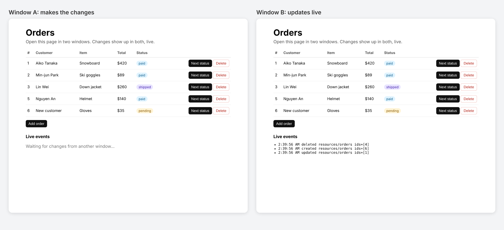

# @hibira-io/refine

[](https://www.npmjs.com/package/@hibira-io/refine)
[](https://github.com/hibira-io/refine/actions/workflows/ci.yml)

A [Refine](https://refine.dev) `liveProvider` for [Hibira](https://hibira.io), or any Pusher-compatible server. Lists, records and dashboards in your Refine admin panel update by themselves when someone else changes the data, the same way [`@refinedev/ably`](https://refine.dev/docs/realtime/live-provider/) does, over [pusher-js](https://github.com/pusher/pusher-js).



- Works with Refine 4 and 5, every UI kit (Ant Design, Material UI, Mantine, Chakra, headless) and every data provider.
- Private channels with your own auth endpoint, so only signed-in staff get events.
- Hooks on the same resource share one subscription.
- A server helper sends live events from your API after each change, and can leave out the tab that made it.
- Already using Laravel Echo? Pass `echo.connector.pusher`.

```sh
npm install @hibira-io/refine pusher-js
# on your backend
npm install pusher
```

## Client

```tsx
import { Refine } from '@refinedev/core';
import Pusher from 'pusher-js';
import { liveProvider } from '@hibira-io/refine';

const pusher = new Pusher(import.meta.env.VITE_HIBIRA_KEY, {
  cluster: 'hkg',
  wsHost: 'ws.hibira.io', // the host shown on your app page
  forceTLS: true,
  channelAuthorization: { endpoint: '/api/hibira/auth', transport: 'ajax' },
});

export const App = () => (
  <Refine
    dataProvider={dataProvider}
    liveProvider={liveProvider(pusher, { channelPrefix: 'private-' })}
    options={{ liveMode: 'auto' }}
    // ...
  >
    {/* ... */}
  </Refine>
);
```

That is all Refine needs. `useList`, `useOne`, `useMany`, `useTable`, `useForm` and `useShow` subscribe to `resources/<resource>`, and with `liveMode: 'auto'` they refetch when an event arrives (`'manual'` only calls `onLiveEvent`). For a custom channel use [`useSubscription`](https://refine.dev/docs/realtime/live-provider/#usesubscription).

Pusher channel names can't contain `/`, so `resources/posts` becomes `resources.posts`, plus `channelPrefix`. Use `'private-'` in production and sign subscriptions on your backend (see [Private channels](#private-channels)). To map names yourself, for example per tenant, pass `channel: (refineChannel) => string` instead.

## Sending events

Refine calls `publish` after every create, update and delete made through its hooks. Pick how that reaches the other browsers.

### From your backend (recommended)

Your API knows about every change, including ones from jobs, webhooks and other apps. Send a live event after saving:

```ts
import Pusher from 'pusher';
import { publishLiveEvent } from '@hibira-io/refine/server';

const pusher = new Pusher({
  appId: process.env.HIBIRA_APP_ID!,
  key: process.env.HIBIRA_KEY!,
  secret: process.env.HIBIRA_SECRET!,
  host: 'ws.hibira.io',
  useTLS: true,
});

// after updating post 42
await publishLiveEvent(
  pusher,
  { resource: 'posts', type: 'updated', ids: [42] },
  { channelPrefix: 'private-', socketId: req.headers['x-socket-id'] },
);
```

`type` is `'created'`, `'updated'`, `'deleted'` or your own. You can also pass a full Refine `LiveEvent` (`{ channel, type, payload, date?, meta? }`). `publishLiveEvents(pusher, events, options)` sends many at once, 10 per request.

`socketId` leaves out the browser that made the change, since Refine already refreshed it. To send it, add `pusher.connection.socket_id` to your API requests, for example with an axios interceptor:

```ts
http.interceptors.request.use((config) => {
  if (pusher.connection.socket_id) config.headers.set('X-Socket-Id', pusher.connection.socket_id);
  return config;
});
```

Then turn browser publishing off: `liveProvider(pusher, { channelPrefix: 'private-', publish: false })`.

### From the browser

By default (`publish: 'client'`) Refine's `publish` goes out as a Pusher [client event](https://pusher.com/docs/channels/using_channels/events/#triggering-client-events). This needs no backend code, but:

- the channel must be private or presence (`channelPrefix: 'private-'`),
- client events must be on for the app (Hibira console → your app → Settings),
- only changes made through Refine in a browser are sent.

Or hand events to your own code: `publish: (event, channel) => fetch('/api/live', { method: 'POST', body: JSON.stringify(event) })`, and call `publishLiveEvent` there after checking the user.

### From Laravel or another backend

Send the event `refine` to the Pusher channel with a JSON body shaped like a Refine `LiveEvent`:

```php
// Laravel: an event that implements ShouldBroadcast
public function broadcastOn() { return [new PrivateChannel('resources.posts')]; } // Echo adds "private-"
public function broadcastAs() { return 'refine'; }
public function broadcastWith() {
    return ['channel' => 'resources/posts', 'type' => 'updated', 'payload' => ['ids' => [$this->post->id]], 'date' => now()->toIso8601String()];
}
```

## Private channels

pusher-js asks `channelAuthorization.endpoint` to sign each private channel. Check the session there:

```ts
// app/api/hibira/auth/route.ts (Next.js)
export async function POST(req: Request) {
  const user = await getUser(req); // your session check
  if (!user) return new Response('Unauthorized', { status: 401 });
  const form = await req.formData();
  return Response.json(pusher.authorizeChannel(String(form.get('socket_id')), String(form.get('channel_name'))));
}
```

## Options

| Option | Default | |
| --- | --- | --- |
| `channelPrefix` | `''` | Put before every Pusher channel name, e.g. `'private-'`. |
| `channel` | | `(refineChannel) => pusherChannel`. Replaces the default mapping and `channelPrefix`. |
| `publish` | `'client'` | `'client'`, `false`, or `(event, pusherChannel) => void \| Promise<void>`. |

Events filter like `@refinedev/ably`: a subscription gets the `types` it asked for (`'*'` for all), and when it has `ids` (or a single `id`), `updated` and `deleted` events only reach it if one of the ids matches. `created` always passes. Ids compare as strings, so `1` matches `'1'`.

## Example

[`example/`](example) is a Refine app with an orders table that updates live across windows, and a small Node API that publishes the events.

## Hibira

[Hibira](https://hibira.io) is a hosted Pusher-compatible realtime service with a free plan. Any Pusher-compatible server works with this package too.

## License

MIT

## 中文摘要

`@hibira-io/refine` 是 Refine 的 `liveProvider`，底層用 pusher-js 連線到 Hibira（或任何 Pusher 相容伺服器）。在 `<Refine>` 傳入 `liveProvider(pusher, { channelPrefix: 'private-' })` 並設 `liveMode: 'auto'`，列表與表單就會在別人修改資料時自動更新。建議由後端在每次修改後呼叫 `publishLiveEvent()`（`@hibira-io/refine/server`）發送事件，並帶 `socketId` 排除發起修改的分頁；也可以用 private 頻道的 client event 直接從瀏覽器發送。Refine 頻道 `resources/posts` 會對應為 Pusher 頻道 `resources.posts`。
